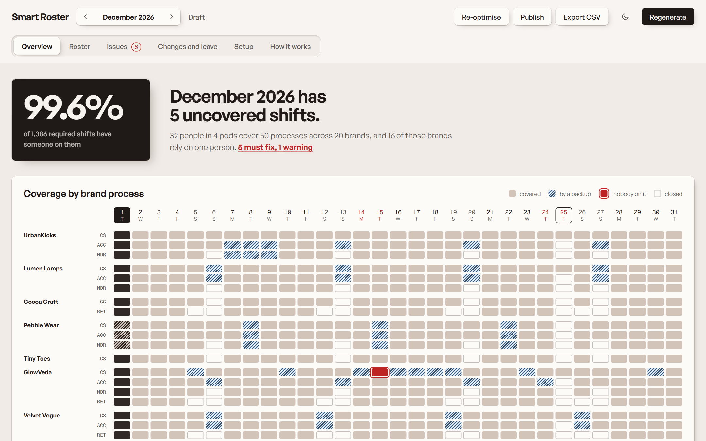
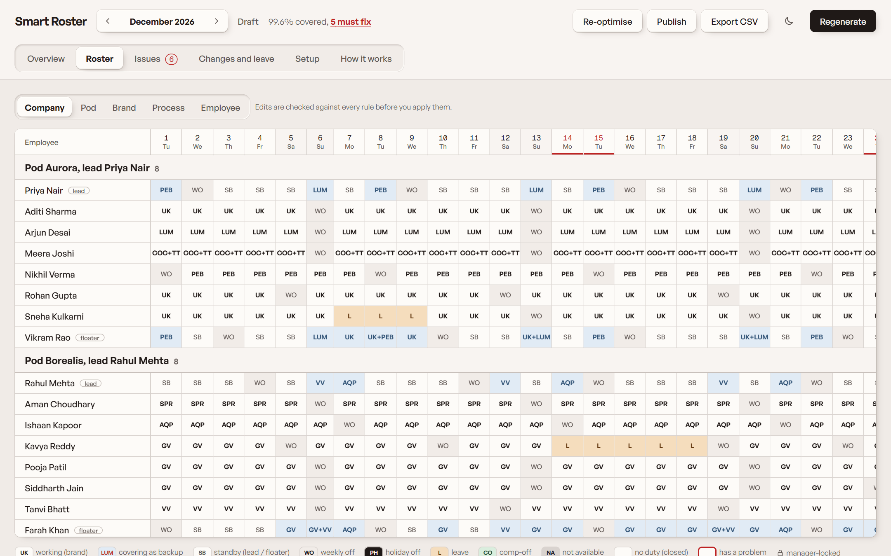
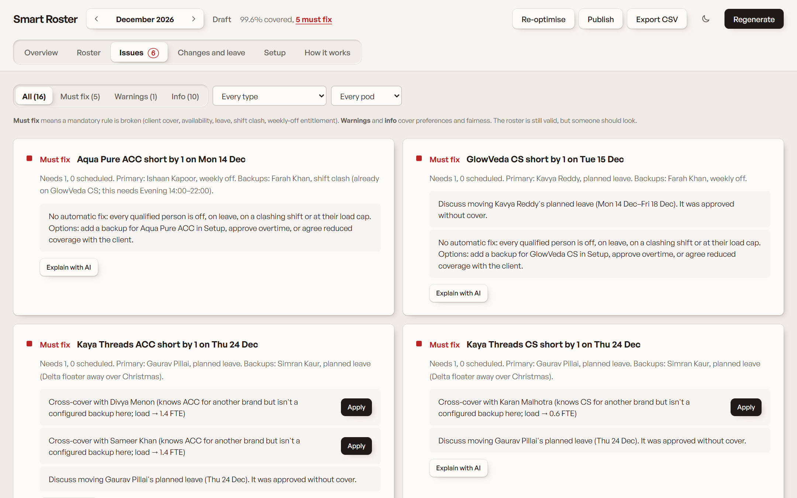
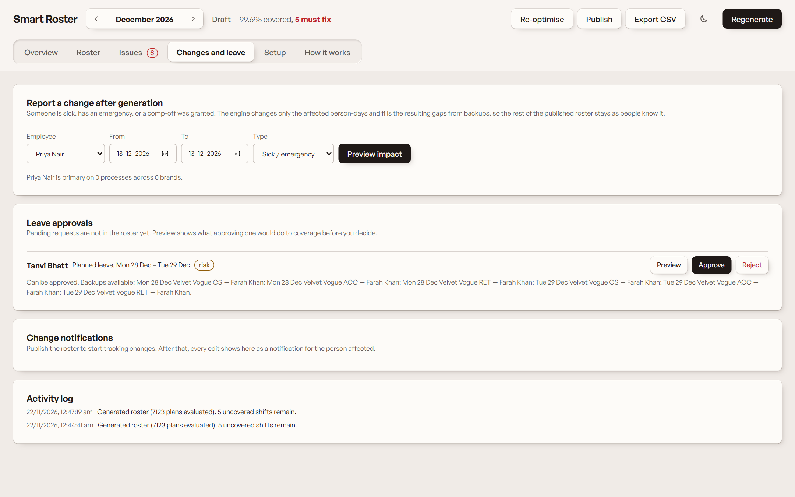

<div align="center">

# Smart Roster

**Plans a month of shifts for a brand-support team, and tells you exactly where it can't.**

[Open the live app](https://smart-roster-rosy.vercel.app) &nbsp;&nbsp;|&nbsp;&nbsp; [Approach note](APPROACH.md) &nbsp;&nbsp;|&nbsp;&nbsp; Demo video: _coming soon_

<br>

<picture>
  <source media="(prefers-color-scheme: dark)" srcset="docs/screens/overview-dark.png">
  
</picture>

</div>

<br>

## The problem

A support company runs customer operations for 20 online brands. Each brand has up to four kinds of work: **Customer Support (CS)**, **Abandoned Cart Conversion (ACC)**, **Non-Delivery Reports (NDR)** and **Retention (RET)**. Each one has its own days. Some run all 365 days, some skip public holidays, some only run Monday to Friday.

The 32 staff are split into four pods. Each pod has a lead and a floater who covers for others. The catch is that 16 of the 20 brands have only one person. When that person takes a weekly off, falls sick or goes on leave, someone else has to step in, or the client gets nobody that day.

Smart Roster plans the whole month around that. It gives everyone their weekly offs, rotates public holidays fairly and puts a backup in for every absence it can. Anything it can't cover stays in red, with the reason.

> **Try it in 30 seconds:** open the [live app](https://smart-roster-rosy.vercel.app), press **Generate roster**, and look at the red cells around Christmas. Kaya Threads has one agent, Gaurav, who is on leave on 24 Dec. The backup, Simran, is away from the 21st to the 26th. Nobody else knows the brand, so the tool shows the gap instead of hiding it.

## A tour of the app

| | |
|---|---|
| **Overview.** The health check. Each row is one brand's piece of work, each column is a day. Grey is covered, blue stripes mean a backup is covering, red means nobody is there. | **Roster.** The schedule itself, by company, pod, brand, type of work or person. Click any day to change it. You see what the change breaks before you apply it, and your edit is locked so regenerating keeps it. Pod leads approve their pod here. |
|  |  |
| **Issues.** The to-do list. "Must fix" means a hard rule is broken. "Warnings" are softer problems. Every issue names who normally covers it, why each of them can't, and what you can do, often with a one-click **Apply**. | **Changes and leave.** For after the roster is out. Report a sick day and the tool changes only that person's days and brings in a backup. Pending leave, drafted messages to the people affected, and a log of every change also live here. |
|  |  |

**Setup** holds all the input data: brands and what they need, people and who backs up whom, pods, holidays and leave, shifts and rules. **How it works** explains the rules inside the app, and first-time visitors get a short guided tour.

## What it covers

| Asked for | How Smart Roster does it |
|---|---|
| One place for employees, brands, processes, pods, leads and allocations | The Setup tab, all editable. The sample has 32 people, 20 brands and 4 pods |
| About 80% one-person brands, the rest with 2 or 3 people | 16 of 20 brands are one-person. UrbanKicks, GlowVeda, BrewHaus and PetPal have teams, some sharing a process and some splitting them |
| Working days set per brand and per process | Each brand process has its own calendar (365 days, daily except holidays, Mon to Sat, Mon to Fri, or custom), plus extra staff on chosen weekdays or dates |
| Availability, weekly offs, leave, comp-offs, public holidays | Per person in Employees, plus Holidays and leave |
| A monthly roster that explains conflicts instead of hiding them | **Generate roster**. Anything it can't solve stays as a red gap with the reason |
| Must-have rules vs nice-to-haves | "Must fix" vs Warning and Info. Publishing with must-fix issues open needs a tick that you know |
| Company, pod, brand, process and employee views | The five Roster views, plus the coverage grid and a "who's working" board on Overview |
| Manual edits that get checked | Click any day: you see what it fixes and what it breaks before applying, and the edit is locked |
| Changes after the roster is out | Changes and leave: report it, preview it, then the smallest repair, or re-plan from a date |
| Shared data | Setup and rosters are stored in Postgres (Neon), so everyone sees the same thing. Saves carry a version, so two people can't silently overwrite each other |

Also built: fair weekly offs and holiday rotation, preferred days off, backup suggestions, one-click fixes, re-planning from a date, pod lead approval before publishing, leave approval with a coverage preview, drafted change messages, CSV export, JSON import and export, AI explanations of issues, dark mode, and adding brands, pods, processes and shifts at any time.

## Run it locally

You need Node 20 or newer.

```bash
npm install
npm run dev
```

Open http://localhost:5173 and press **Generate roster**. To start over, go to Setup, then Data, then *Reset to sample data*.

Two optional settings go in `.env` (copy `.env.example`):

| Variable | What it's for | Without it |
|---|---|---|
| `DATABASE_URL` | A Postgres connection string. Neon's free plan works. Tables are created and filled with sample data on the first request | The top bar says *This browser only* and data stays in this browser |
| `ANTHROPIC_API_KEY` | The "Explain with AI" button | The button says AI isn't available. The engine's own explanation always shows |

```bash
npm test         # engine tests
npm run build    # type-check and production build
```

### Deploy to Vercel

1. Push the repo to GitHub and import it in Vercel (**Add New**, then **Project**). Vite is detected, nothing to change.
2. Add a database: **Storage**, **Create Database**, **Neon**, and connect it to the project. That sets `DATABASE_URL`.
3. Optionally add `ANTHROPIC_API_KEY` under **Environment Variables**.
4. Deploy. Each file in `api/` becomes a serverless function.

## How it's built

```
src/
  engine/            plain TypeScript, no React, with tests
    types.ts         the data model
    context.ts       indexes one month: who covers what, how many are needed each day
    generate.ts      builds the roster, and repairs it after a change
    validate.ts      every rule, coverage, per-person stats, explanations and suggested fixes
    actions.ts       manual edits, locks, applying a suggestion, diff against the published roster
    approval.ts      pod lead sign-off, cancelled when that pod's days change
  data/seed.ts       the sample company
  state.tsx          app state; loads and saves through the API
  worker.ts          generation runs in a Web Worker so the page never freezes
  views/             Overview, Roster, Issues, Changes, Setup, How it works
api/
  state.ts           GET everything, PUT the setup, POST ?reset=1
  roster.ts          PUT or DELETE one month's roster
  explain.ts         AI explanation of one issue (Claude API)
  _lib/db.ts         tables, sample data, transactions, version checks
  _lib/http.ts       request checks and error responses
```

The engine doesn't know about the UI, so the same code runs in the browser, in the worker and in the tests.

### Database

```
workspace(id, version, policy)            one row; version goes up on every setup save
pods(id, name, lead_id)                   brands(id, name, code, pod_id → pods)
process_types(id, code, name, color)      shifts(id, name, start_time, end_time)
requirements(id, brand_id → brands, process_id → process_types, shift_id → shifts,
             calendar, min_staff, weekday_min, date_min, effort)
employees(id, name, pod_id → pods, role, offs_per_week, available_weekdays, preferred_off_days,
          max_load, comp_off_opening, active)
assignments(id, employee_id → employees, requirement_id → requirements, role PRIMARY|BACKUP)
holidays(date, name)                      leaves(id, employee_id → employees, start_date, end_date, type, status, note)
rosters(month, version, status, body)     one row per month; body holds the days, log and approvals
```

Saving the setup is one transaction: lock the workspace row, check the version the browser started from, rewrite the tables, bump the version. Foreign keys and checks reject a broken setup, like a brand in a pod that doesn't exist, and the API answers 400. Each month's roster has its own version, so two managers working on different months never collide. If two people edit the same thing, the second save gets a 409, and the app loads the newer version and says so.

The top bar shows where things stand: *Saved*, *Saving…*, *Not saved, retry*, or *This browser only* when the database can't be reached.

## Tell us how you think

### 1. How did you model the data?

Early on I noticed I kept mixing up two different questions: when does a client need someone, and when is a person able to work? So I kept them as two separate sets of data.

The client side is built from what I call requirements. A requirement is one type of work for one brand, like GlowVeda's NDR. Each one has its own days (which weekdays, and whether it runs on public holidays), a shift and a minimum number of people. A sale day can ask for 2 people and a closure day for 0. Each requirement also has a size, as a fraction of one person's day. That's how one person can run all three small processes of a brand (0.3 + 0.3 + 0.4) while a busy queue takes someone's whole day.

The people side holds each person's pod, role (agent, lead or floater), how many offs they get a week, which weekdays they can work at all, which days they'd like off, how much work they can take in a day, and their comp-off balance. Leave and public holidays sit on top of that.

Assignments connect the two: a person is either the primary or a backup on a requirement. The roster itself is just a grid with one cell per person per day. Each cell says what that person is doing that day (working, weekly off, holiday, leave, comp-off, not available or nothing to do), and if they're working, on which brand and whether as backup. I never store "single-resource" as a flag. The app works it out from the assignments (a brand with one primary), so it stays right when someone edits Setup.

### 2. How does generation work, and how does it satisfy constraints?

With 30 to 60 people and one month, I didn't need a heavy solver. A simple build-then-improve approach is fast enough, and I can explain every decision it makes, which matters here because a manager has to trust it.

1. It starts with what can't move: approved leave, comp-offs, days someone can't work, and any day a manager has locked.
2. The real decision is which day or days each person takes off in each Monday-to-Sunday week. When a week runs across two months, it reads the other month's roster, so nobody ends up with two offs, or none, at the changeover.
3. It then fills in each day. Primaries work their brands. If a process is closed that day, its people have nothing to do. On a public holiday only as many people work as the client needs, and they're picked by who has worked the fewest holidays so far. Each holiday worked earns a comp-off.
4. Any gap left gets a configured backup. The backup has to be free, on a shift that fits (the day can't stretch past 10 hours by default) and not overloaded. People in the same pod go first, then whoever has done the least backup work. If someone knows the process but isn't set up as its backup, the tool never puts them in on its own. It offers them as a suggestion instead.
5. Then it tries moving people's offs around, first one person at a time and then two people together in the weeks with problems, and keeps each change that makes the roster better. An uncovered shift costs far more than anything else (1000 points, against 4 for a missed preference), so it will never leave a client uncovered just to give someone their preferred day off. The weekly-off entitlement can't be traded away at all.
6. Finally it runs the same checks the app runs after every manual edit.

The December sample takes about 2 seconds and reaches 99.6% coverage. Five shifts stay uncovered, because nobody in the data can work them, and the app explains each one.

### 3. Single-resource brands vs multi-employee brands

On a one-person brand, that person's weekly off leaves the brand empty on any day it's open. So for these brands the tool plans the off and the cover for it together. Where it can, it puts the off on a day the brand is closed, which for a Monday-to-Saturday brand is Sunday. For a brand that runs every day, it picks a day when a backup is free and on a matching shift. It also spreads the backup work so one floater isn't covering three brands on the same day.

Brands with a team are easier. The team's offs are staggered so the minimum is met every day, and busier weekdays get more people (UrbanKicks needs 2 on Mondays). On public holidays only the number needed work, and that rotates fairly. Two people sharing one support queue and two people on different processes use the same setup: each requirement has its own list of primaries.

### 4. What happens when a single-resource employee is unavailable?

The manager enters it in Changes, or it comes in as approved leave. By default the tool does the smallest fix it can: it changes only that person's affected days, then fills each gap from the process's backups in order (free, matching shift, not overloaded, same pod first, least backup work so far). You see every change and the new coverage before anything is saved.

If no backup can do it, the gap stays as a must-fix issue. It names everyone who could normally cover and why each can't, then lists what's left: someone who knows the process covering for one day (it shows how much extra work that puts on them), moving someone's weekly off, looking at the leave again, or agreeing lower cover with the client. If the roster was already published, the tool drafts a message for each person affected.

The other choice is to re-plan from a date. Everything before that date stays, locked days stay, and offs after it are planned again. That can close gaps a single backup can't, but more people's plans change, so the manager decides. The smallest fix is the default.

### 5. How are conflicting requirements and insufficient staffing handled?

I didn't want the tool to ever produce a roster that looks fine but isn't, so the rules have a fixed order:

- These are never broken: approved leave and availability, one compatible shift per person, the daily workload limit, and the weekly offs everyone is owed.
- This is what it tries hardest for: every client covered.
- These matter less: not working too many days in a row, sharing holidays fairly, people's preferred days off.

When there aren't enough people, the gap stays on the roster as a must-fix issue that says why, for example "Primary: Gaurav, planned leave. Backup: Simran, planned leave," and what would fix it. If a fix needs one of the softer rules bent, like a long cross-cover or a moved off, the tool offers it as a suggestion and doesn't apply it quietly. Some setup problems get flagged before they ever turn into gaps, like a process with no primary, or pending leave that would leave a brand empty. And if you publish with must-fix issues still open, you have to tick that you know, and that gets logged.

### 6. What is automated and what is left to humans?

The tool handles the routine work: planning weekly offs, rotating holidays and tracking comp-offs, assigning backups, finding every conflict and explaining it, suggesting fixes, repairing the roster after a change, drafting change messages, and showing what any edit or leave request would do before it's applied.

Anything that weighs one person or client against another stays with people: approving leave, accepting a long cross-cover or overtime, agreeing lower cover with a client, a pod lead signing off their pod, and publishing. The tool shows what each choice means and puts the button right there, but a person presses it. When a manager edits a day it gets locked, so regenerating never undoes their decision. The AI explanation only rewords what the engine already found and can't change the roster.

### 7. What changes if the team doubles?

The work grows roughly with the number of people times the number of weeks. Each change only recalculates the days it touches, and the two-person moves only look at people in problem weeks, so 60 to 70 people still generates in a few seconds in the background. Beyond that I'd split the problem by pod. Pods share very few backups, so each pod can be planned on its own, in parallel, with one last pass for the floaters that cover more than one pod.

The bigger changes would be around the tool, not in the scheduling logic:

- The shared Postgres database is already there. At that size I'd move the change log into its own table, one row per change with who made it and when, instead of keeping it inside each month's roster.
- Logins and roles, so only a pod's own lead can approve it, and only ops managers can publish. Right now anyone can press "Approve as".
- Real email or Slack notifications instead of drafted messages.

The data model stays the same.

### 8. What would you improve with one more week?

- When gaps are left, I'd hand the off-day decisions to a proper solver (CP-SAT or ILP). Then the tool could prove a gap can't be filled, instead of only saying it didn't find a way.
- I'd plan across months. Right now January can't move December's last week, so a few too-many-days-in-a-row warnings show up at the changeover. A rolling window would fix that.
- Logins and roles, so pod lead approval is tied to the lead's own account, plus real email or Slack notifications.
- Skill levels instead of "knows this process or doesn't", and shift preferences, not just preferred days off.
- Minimum staffing worked out from each brand's expected ticket volume instead of fixed numbers.
- More tests, especially tests that run lots of random datasets and check that no hard rule ever breaks, plus end-to-end tests of the UI.

## Assumptions

- Weeks run Monday to Sunday; weekly-off entitlement is counted per full week.
- Working a public holiday earns one comp-off.
- Pod leads carry a reduced load (0.6 FTE) so they have time to lead; floaters have no brand of their own.
- One shift per process; a person may cover two processes on one day if the combined span is within the limit (10 h by default).
- Sample data covers December 2026 and January 2027 (holidays and leave are seeded for both). December contains deliberately unsolvable situations to show how conflicts are explained.

---

Built by Mohak Malviya for the DATASTRAW assessment. [LinkedIn](https://www.linkedin.com/in/mohak-malviya-a6b89b225)
